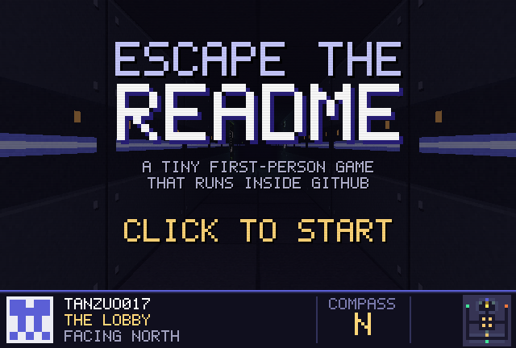
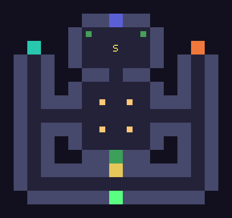

<div align="center">

<a href="play/start.md"></a>

# Escape the README

**A first-person maze you play inside GitHub's markdown viewer.**<br>
No JavaScript, no server, no Actions. Just 288 pre-rendered views and a lot of links.

### [▶ Click here to play](play/start.md)

</div>

---

## How it works

GitHub won't run code in a README, but it will follow links. So the whole game is computed ahead of time:

1. **The level** is a 17×16 grid of characters at the top of [`tools/build.py`](tools/build.py): bricks, tech panels, posters, lamps, plants and an exit door.
2. **A small raycaster** written in NumPy renders the view from every walkable cell in all four directions. It handles textured walls, floor and ceiling casting, billboard sprites with a depth buffer, coloured point lights, bloom and fog.
3. **Every view becomes a page.** [`play/8-3-N.md`](play/8-3-N.md) means "standing at (8, 3), facing north". Its **WALK**, **RUN**, **LEFT**, **RIGHT** and **TURN** buttons link to the neighbouring pages. **RUN** jumps straight down a corridor to the next junction or poster.
4. **Clicking is the game loop.** Each click asks GitHub for the next page, and that's the whole engine.
5. **Preloading hides the image wait.** Each page also carries 1×1-pixel copies of every view one click away, linked straight from `raw.githubusercontent.com`. GitHub's own relative image links go through an uncacheable redirect, so they can't be preloaded. When you click, the next frame is already in your browser cache.

All the art is drawn procedurally by the same script: brick and panel textures, the project posters, the lamp and plant sprites, the HUD and the 5×7 pixel font. Nothing comes from an existing game.

| | |
|---|---|
| States | 72 walkable cells × 4 facings = 288 pages |
| Frames | 640×432 WebP, about 20 KB each |
| Build | about 30 seconds on a laptop |

<details>
<summary>🗺️ Map (spoilers)</summary>
<br>

</details>

## Rebuild it

```bash
pip install pillow numpy
python tools/build.py
```

To reshape the maze, edit `LEVEL`. Poster text and links live in `POSTERS` and the `tex_*` functions.

## Credits

The idea of a game made from linked markdown pages comes from Kuber Mehta's [DoomMe](https://github.com/Kuberwastaken/DoomMe). The engine, level and art here are original.

MIT licensed. Made by [@tanzuo017](https://github.com/tanzuo017).
