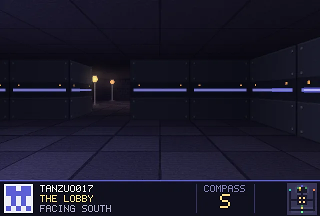
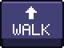

<!-- Escape the README · generated by tools/build.py -->

Click the view or <b>WALK</b> to step forward · each click loads a new page, so give GitHub a second · <a href="start.md">restart</a> · <a href="../README.md">how this works</a> · <a href="https://github.com/tanzuo017">back to my profile</a>

