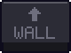
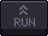
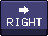
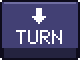
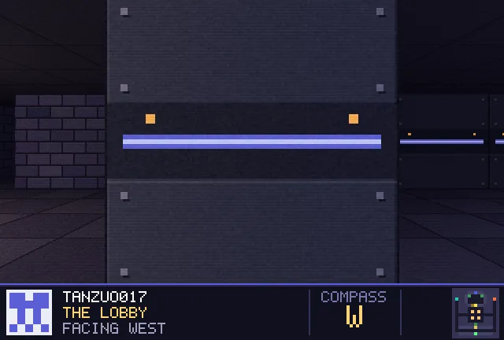
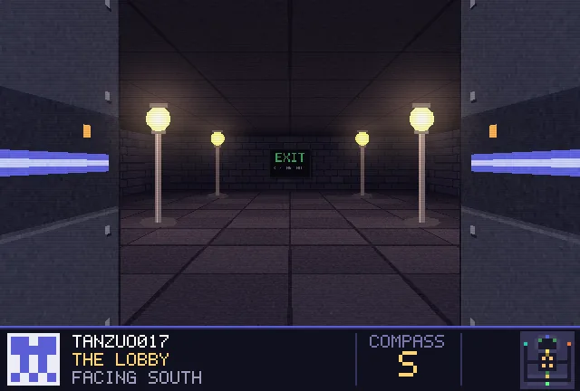
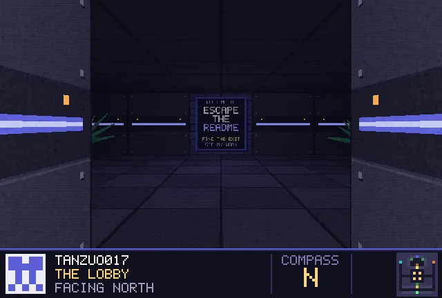
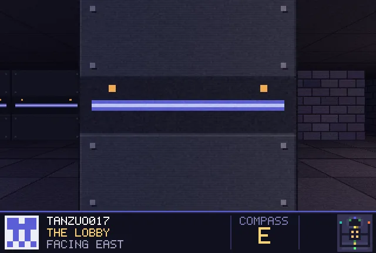

<!-- Escape the README · generated by tools/build.py -->

<b>WALK</b> (or click the view) steps forward · <b>RUN</b> dashes to the next junction · <a href="start.md">restart</a> · <a href="../README.md">how this works</a> · <a href="https://github.com/tanzuo017">back to my profile</a>

