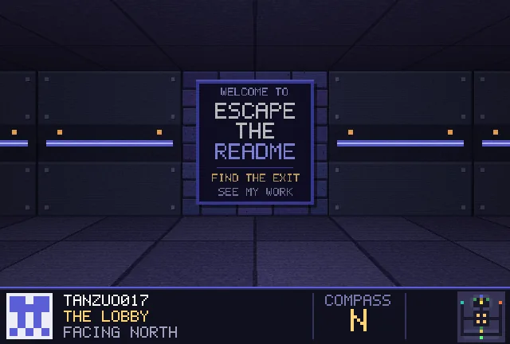
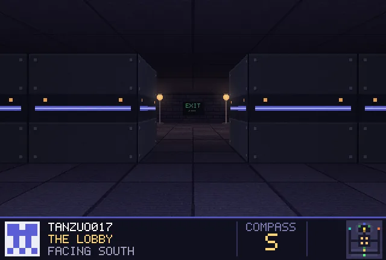
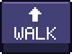
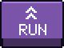
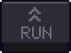

<!-- Escape the README · generated by tools/build.py -->

<b>How to play:</b> <b>WALK</b> steps forward, <b>RUN</b> dashes to the next junction, <b>LEFT</b>/<b>RIGHT</b> turn 90°, <b>TURN</b> spins you around. 
Find the exit. My projects are hanging on the walls along the way.

<a href="../README.md">how this works</a> · <a href="https://github.com/tanzuo017">back to my profile</a>

