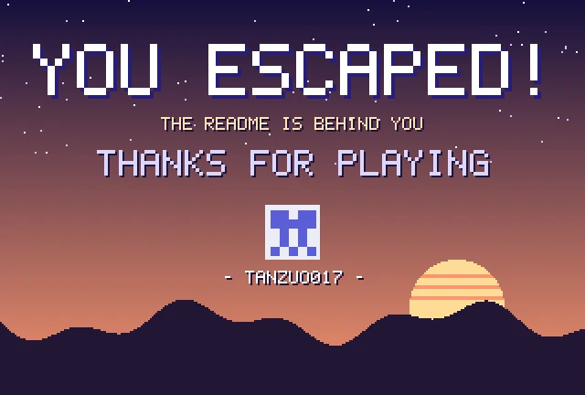

<!-- Escape the README · generated by tools/build.py -->

### You made it out 🎉

Thanks for playing! While you're here:

<a href="https://github.com/tanzuo017/NTEST-clinical-digitization-tool"><b>NTEST</b></a>: bilingual clinical data-entry tool 
<a href="https://github.com/tanzuo017/find_a_child"><b>Find Every Child</b></a>: measles outbreak response campaign site

<a href="start.md">play again</a> · <a href="../README.md">how this works</a> · <a href="https://github.com/tanzuo017/escape-the-readme">⭐ star the game</a>

